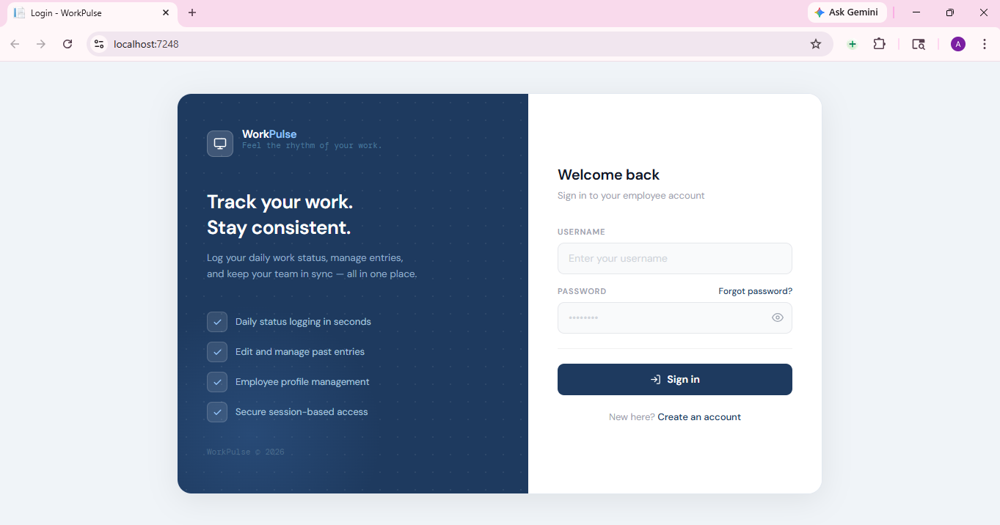
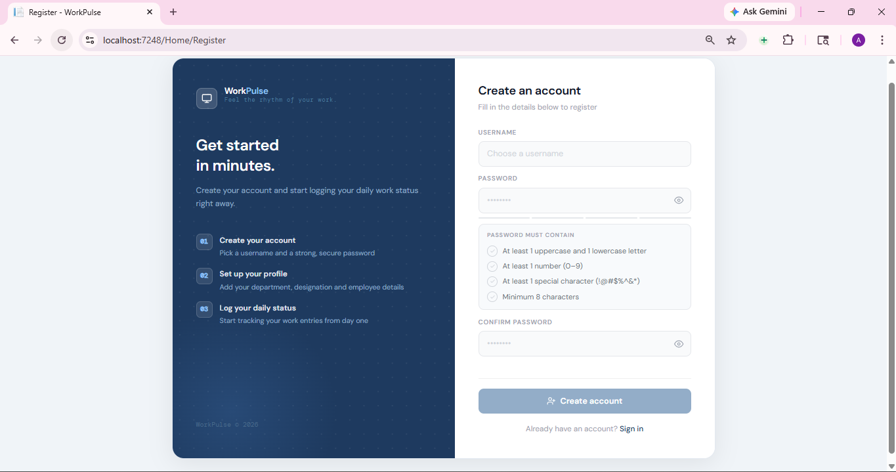
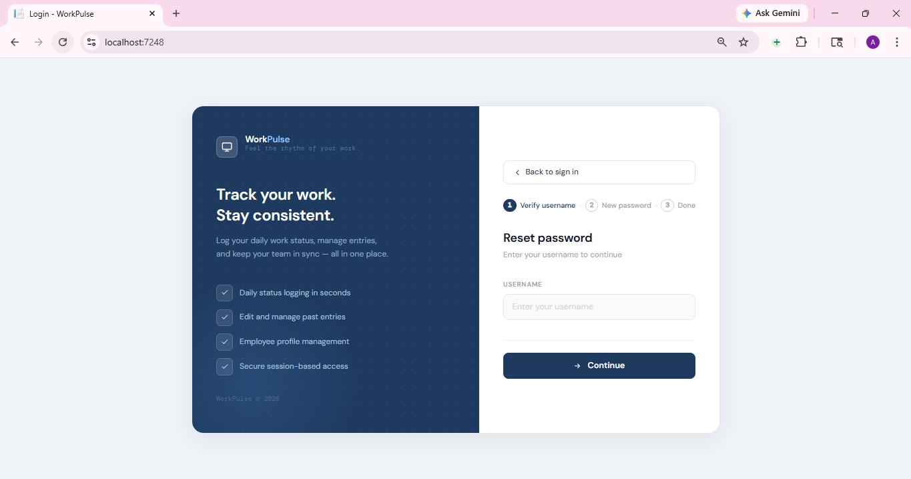
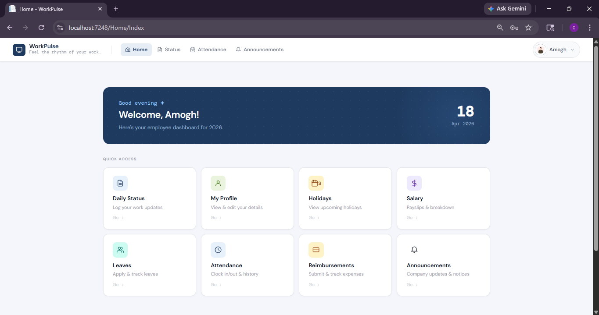
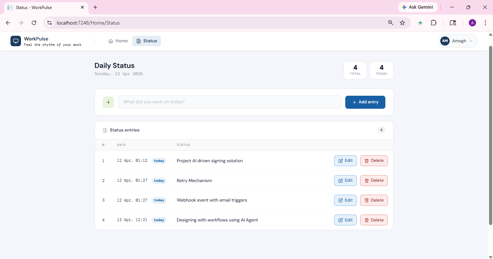
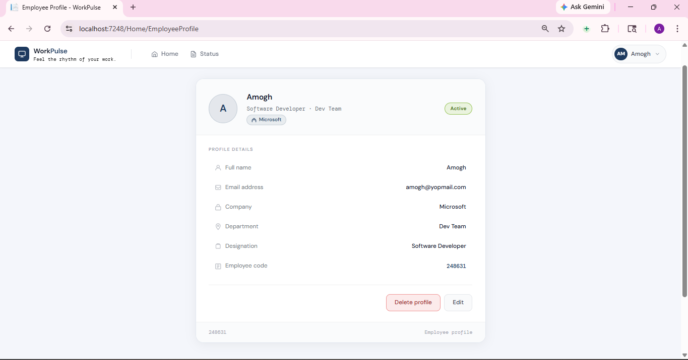

# 🖥️ WorkPulse 

> **Feel the rhythm of your work.**

WorkPulse is an employee self-service web application that lets you log daily work status, manage your profile, and stay organized — all in one place.

---

## ✨ Features

- 📋 **Daily Status Logging** — Log what you worked on each day in seconds
- ✏️ **Edit & Manage Entries** — Update or delete past status entries anytime
- 👤 **Employee Profile Management** — View and edit your profile details (name, department, designation, employee code)
- 🔐 **Secure Session-Based Access** — Auth protected with username/password login
- 🔑 **Password Reset Flow** — Step-by-step guided reset (verify username → new password → done)
- 🚀 **Coming Soon** — Holidays, Salary/Payslips, Leaves, and Raise a Request

---

## 📸 Screenshots

### Login Page


### Register Page


### Forgot Password


### Employee Dashboard


### Daily Status


### Employee Profile


---

## 🛠️ Tech Stack

- **Framework:** ASP.NET Core MVC (C#)
- **Frontend:** Razor Views, HTML/CSS
- **Port:** `localhost:7248`

---

## 🚀 Getting Started

### Prerequisites

- [.NET SDK](https://dotnet.microsoft.com/download) (version 6.0 or later)
- Visual Studio or VS Code

### Run Locally

```bash
# Clone the repository
git clone https://github.com/Amoghdev57/WorkPulse.git

# Navigate into the project
cd WorkPulse/WorkDailystatus

# Run the application
dotnet run
```

Open your browser and go to `https://localhost:7248`

---

## 📂 Project Structure

```
WorkPulse/
├── WorkDailystatus/        # Main ASP.NET MVC project
│   ├── Controllers/
│   ├── Models/
│   ├── Views/
│   └── ...
├── screenshots/            # App screenshots
├── .gitignore
└── README.md
```

---

## 📋 Pages Overview

| Page | URL | Description |
|------|-----|-------------|
| Login | `/` | Sign in with username & password |
| Register | `/Home/Register` | Create a new employee account |
| Dashboard | `/Home/Index` | Quick access to all features |
| Daily Status | `/Home/Status` | Log and manage work entries |
| Employee Profile | `/Home/EmployeeProfile` | View and edit profile details |
| Forgot Password | `/` (modal) | 3-step password reset flow |

---

## 🔮 Roadmap

- [ ] Holidays calendar
- [ ] Salary & payslip breakdown
- [ ] Leave application & tracking
- [ ] Raise a Request (PF, Form 16, etc.)

---

## 📄 License

This project is private. © WorkPulse 2026
